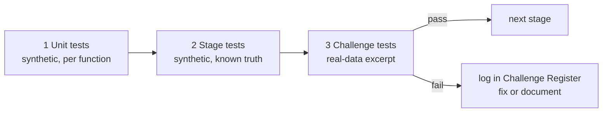
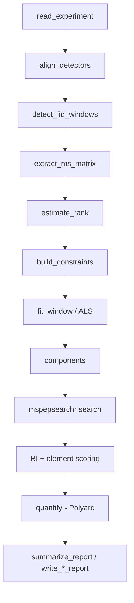

# moosaic — Package Specification

Status: draft v2. Derived from `Workplan.md`, with `als-data-prep.md` and `fidms.md` as references. Open questions from v1 resolved in section 1.
Scope: GC-FID/MS raw data → FID-guided windowed MCR-ALS deconvolution → library search → RI/element-filtered identification → Polyarc quantification → report.

## 0. Conventions (apply to every file)

| Rule | Detail |
|---|---|
| One function per file | `R/{function_name}.R`; internal helpers dot-prefixed, file named without the dot (e.g. `.estimate_delay()` → `R/estimate_delay.R`). |
| Tests mirror files | `R/{name}.R` → `tests/testthat/test-{name}.R`. Tests written **before** implementation (TDD). |
| Test descriptions | Plain behavioural descriptions, **no issue labels** (e.g. `test_that(".bin_spectrum() sums intensities within a bin", ...)`). |
| Errors/messages | `cli::cli_abort()`, `cli::cli_warn()`, `cli::cli_inform()` via `.moosaic_abort(message, class, call)` / `.moosaic_warn()`; classes `moosaic-error-{class}`, `moosaic-warning-{class}`. Messages name the calling function with `{.fn}`. |
| Documentation | Full roxygen for **all** functions incl. internal (`@keywords internal`): `@param`, `@return` (with structure), `@details`, `@examples` (exported). |
| Validation | Validate parameters where they are used; propagate `call = rlang::caller_env()`. |
| Style | `|>`, `\(x)` lambdas, `air format .`, `lintr`, ASCII only. Tibbles for tabular output. |
| Coverage | 100% per file (excluding `R/moosaic-package.R`, `R/aaa-*.R`). |
| fidms code | Port (copy & adapt) required quantification/reporting code. **Not** a dependency. Exclude ASTM D2425 / hydrocarbon-type code. |

### Dependencies (to confirm with developer)

| Imports | Why |
|---|---|
| chromConverter | read ChemStation `.ms` / `.ch` |
| ALS | MCR-ALS solver (`ALS::als()`) |
| GCalignR | default alignment engine |
| mspepsearchr | NIST MSPepSearch wrapper (GitHub only → `Remotes: andreysamokhin/mspepsearchr`; Windows native, Wine elsewhere) |
| cli, rlang, tibble, dplyr, purrr, Matrix, nnls, openxlsx, stats, utils | as before |

| Suggests | quarto, testthat (>= 3.0.0), withr |
|---|---|

Dependencies approved. `ALS` installed and behaviour verified (1.2).

---

## 1. Resolved decisions (from v1 open questions)

### 1.1 Input formats (observed from real data: `26241-01 phenols`)

Read with `data_format = "long"`, `format_out = "matrix"` (smallest memory; `data.frame`/`data.table` also possible). FID read with `scale = TRUE` (chromConverter default: applies the file's scaling factor; `intensity_multiplier` is then informational only).

| | FID (`read_chemstation_ch`) | MS (`read_chemstation_ms`) |
|---|---|---|
| Shape | matrix `[n, 2]`: `rt`, `intensity` | list: `MS1` `[n, 3]` (`rt`, `mz`, `intensity`), `BPC` `[n_scans, 3]`, `TIC` `[n_scans, 2]` |
| Size (example) | 284,995 points | 2,317,585 rows, 21,119 scans |
| Sampling | 0.000333 min (0.02 s, 50 Hz) | 0.0045 min (0.27 s) per scan |
| rt range | -0.00016 – 95.0 min (note negative first point) | 0.092 – ~95 min |
| m/z | — | fractional, 0.1 resolution (e.g. 39.9), range 15.1–398.4 |
| Units | pA, `scaled = TRUE`, `intensity_multiplier` attr | counts, `scaled = FALSE` |
| Metadata | attributes: `sample_name`, `method`, `operator`, `run_datetime`, `detector_range`, `source_file`, `source_sha1`, ... | same set on each list element (`detector_id = "5975 GCMS"`) |

Consequences for design:
- ~14 FID points per MS scan → FID must be **resampled onto the MS scan grid** for C0 (boxcar mean over each scan interval, not point interpolation, to avoid aliasing narrow peaks).
- m/z are fractional → nominal binning uses `round(mz)` (centre on integers, so 39.9 → 40); `mz_bin` stays an option.
- Whole-run dense D ≈ 21,119 × 466 doubles ≈ 79 MB: acceptable, but store whole run as sparse `dgCMatrix`; densify per window only.
- The supplied `TIC` is used directly for alignment (no need to rebuild); `.build_tic()` remains as a fallback/check.
- Metadata pulled from attributes into `metadata` lists.

### 1.2 ALS (`ALS::als()`, from CRAN Rd)

```r
als(CList, PsiList, S = matrix(), WList = list(), thresh = .001, maxiter = 100,
    forcemaxiter = FALSE, optS1st = TRUE, x = 1:nrow(CList[[1]]), x2 = 1:nrow(S),
    baseline = FALSE, fixed = vector("list", length(PsiList)),
    uniC = FALSE, uniS = FALSE, nonnegC = TRUE, nonnegS = TRUE, normS = 0, closureC = list())
```
Returns `list(CList, S, rss, resid, iter)`.

Mapping: `PsiList = list(D)`, `CList = list(C0)`, `S = S0` (n_mz × comp), `x = rt`, `x2 = mz`, `uniC = TRUE`, `normS = 1` (max = 1).

Verified in the R session (ALS installed) on a synthetic 2-analyte + flat-background problem:
- `baseline = TRUE` exempts the **last column** of C from unimodality (source: `ALS:::getC` loops `1:(ncol(C) - 1)` when `baseline`). Background component must therefore be the last column — matches the spec.
- Recovered C and S correct; background column recovered as flat ~0.1; spectra max = 1 with `normS = 1`.
- `als()` prints iteration progress to stdout on every call → wrap in `utils::capture.output()` (or `suppressMessages` if it uses `message`; it uses `cat`) and keep the trace in `diagnostics$trace` for debugging.
- RSS can **increase** on the final iteration (RD negative: 4.81e-07 → 5.30e-07); stopping fires on `RD < thresh` including negatives. Diagnostics should record the final RD; a unit test should check the result is still returned.
- `iter` is numeric, counts half-steps (S and C each count as 1), so `maxiter = 100` ≈ 50 full cycles. `converged <- iter < maxiter`.
- `$S` returned is the optimised S (the Rd text "S given as input" is wrong); C in `$CList` is scaled by amplitudes.
- Stopping rule is relative RSS change (`thresh`), option `moosaic.als_thresh` (default 0.001).
- Also supports multiple datasets sharing S — future option to fit adjacent windows jointly.
- `ALS::matchFactor()` available for spectral similarity in tests.

### 1.3 Library search (`mspepsearchr`)

- Functions: `IdentitySearchEiNormal()` (default), `SimilaritySearchEiSimple()`, `SimilaritySearchEiHybrid()`, `SimilaritySearchEiNeutralLoss()`.
- Args: `spectra` (MSP path **or** list of `list(name, mz, intst, retention_index, ...)`), `libraries` (char vector of **NIST-format library directories**), `n_hits`, `ri_column_type`, `n_threads`, `addl_cli_args`.
- Output: list of data frames (one per query; `attr(, "unknown_name")`) with `name, mf, rmf, prob, formula, mw, inchikey, cas, ri`.
- Consequence: spectra passed **in-memory** (no temp MSP needed); `write_msp()` kept only as a user export.
- Libraries: whatever MSPepSearch accepts. `moosaic.library_path` stores a **list of path strings** (`list("C:/NIST23/MSSEARCH/mainlib/", "C:/NIST23/MSSEARCH/replib/")`), unlisted to a character vector when passed to `libraries`. moosaic only checks the paths exist; format validation is left to MSPepSearch.
- Later extension: built-in `.msp` self-search for users without NIST libraries (section 20).

### 1.4 RI calibration (`ONSITE.CAL`, confirmed)

Whitespace-delimited, no header, one alkane per line: `rt  RI  col3  col4  name`, e.g. `5.850 800.0 100 100 Octane`. Columns 3–4 (`100 100`) are carried through as `col3`/`col4` (meaning to confirm; likely ChemStation response fields, unused). The name may contain spaces → parse first four tokens as numeric and join the remainder as name.

General requirements (calibration files vary between users):
- Reference compounds are **arbitrary**: n-alkanes, aromatics (benzene, toluene, naphthalene), alkylcyclohexanes, polycyclics, etc. RI values need not be multiples of 100 or evenly spaced. No assumptions about carbon number, compound class, or count.
- `.compute_ri()` uses only the (rt, RI) pairs, by piecewise linear interpolation between neighbouring references:
$$RI = RI_i + (RI_{i+1} - RI_i)\,\frac{t - t_i}{t_{i+1} - t_i}$$
- rt outside the calibrated range → RI `NA` + warning (option `moosaic.ri_extrapolate = FALSE`; when `TRUE`, linear from the two nearest points).
- `ONSITE.CAL` is used only as a format/parsing fixture, not to define expected chemistry.
- The file lives in the workspace root for now; copy to `tests/testthat/fixtures/ri/ONSITE.CAL` as a fixture and add to `.Rbuildignore`.

Validation in `read_ri_calibration()`: ≥ 2 rows; rt strictly increasing; RI strictly increasing; numeric parse failures abort with line number.

### 1.5 Spectrum normalisation

Internal: max = 1 (`normS = 1`). MSP export / search input: scaled to max = 999, integer.

### 1.6 Alignment engine

Default `"gcalignr"`. GCalignR aligns **peak lists** (RT + area), not continuous traces, so: detect peaks in FID and TIC → convert to GCalignR input → linear shift estimate. Internal cross-correlation (`"xcorr"`) kept as fallback/cross-check. Disagreement > 1 scan between engines → `cli_warn`.

---

## 2. Testing strategy: unit tests before stage challenge tests

Every stage follows the same gate sequence. A stage is not "done" until all three levels pass or the identified challenge is logged.



| Level | Data | Where | Purpose |
|---|---|---|---|
| 1. Unit | tiny hand-built vectors/matrices | `test-{function}.R` | exact behaviour, edge cases, errors |
| 2. Stage | `make_synthetic_run()` with known truth | `test-{orchestrator}.R` | function composition recovers ground truth |
| 3. Challenge | real-data excerpts (fixtures) | `test-challenge-{stage}.R` | expose real-world problems before integration; `skip_if_not(file.exists())` |
| 4. Integration | full synthetic run, then full real run | `test-integration-*.R` | only after all stage challenges reviewed |

### Fixtures

| File | Content | Built by |
|---|---|---|
| `fixtures/chromconverter_fid_excerpt.rds` | 3-minute FID slice (with attributes) from the phenols run | `data-raw/make_fixtures.R` |
| `fixtures/chromconverter_ms_excerpt.rds` | matching `MS1`/`TIC`/`BPC` slice | same |
| `fixtures/real_windows/*.rds` | hand-picked windows: isolated peak, co-eluting pair, shoulder, trace near large peak, bleed region | same |
| `fixtures/ri/ONSITE.CAL` | RI calibration sample | copied manually |
| `fixtures/search/hits.rds` | saved `mspepsearchr` output for 3 spectra | recorded once on Windows |

Excerpts keep the repo small; large raw files never committed.

### Synthetic helper

`tests/testthat/helper-synthetic.R`: `make_synthetic_run(n_comp, centers, widths, spectra, carbons, delay, noise, fid_hz = 50, scan_s = 0.27, seed)` — produces a known-truth `gcms_fid_exp` mirroring real sampling rates and fractional m/z. Used at level 2 only; level-1 tests construct their own minimal inputs inline.

### Challenge register

`dev/challenges.md` (Rbuildignored): one entry per failed/surprising challenge test — stage, fixture, symptom, cause, decision. Anticipated items to test for explicitly:

| Stage | Anticipated challenge |
|---|---|
| Read | negative first FID rt; scan rows with zero ions; `intensity_multiplier` already applied? |
| Convert | fractional m/z rounding at x.5 boundaries; memory for whole-run matrix |
| Align | big-little/little-big peak pairs; FID/MS response differences (MS weak for small oxygenates, FID weak for CO2/water); solvent peak dominating correlation |
| Detect | baseline drift late in run; solvent tail; very wide or very narrow peaks vs 0.27 s scans (few scans/peak) |
| Rank | rank inflated by noise/background; fewer scans than components in narrow windows |
| Constraints | shoulders not resolvable in FID; FID/MS peak shape differences (MS tailing) |
| ALS | rotational ambiguity; non-convergence; background column absorbing real analyte; saturated MS peaks |
| Search | MSPepSearch requires NIST-format libraries; Windows-only executable |
| Quant | apportioning raw FID area when components overlap strongly; Polyarc baseline not at zero |

---

## 3. Options / user configuration

All defaults in **one file**: `R/aaa-options.R` (`.moosaic_default_options()`); `.onLoad()` sets only unset options so `.Rprofile` customisation wins.

| Option | Default | Used by |
|---|---|---|
| `moosaic.library_path` | `NULL` (list of path strings) | search |
| `moosaic.ri_extrapolate` | `FALSE` | RI outside ladder |
| `moosaic.search_function` | `"identity"` (`"identity"`, `"simple"`, `"hybrid"`, `"neutral_loss"`) | search |
| `moosaic.search_hits` | `10L` | search |
| `moosaic.search_threads` | `1L` | search |
| `moosaic.ri_column_type` | `"semi-standard non-polar"` (validate against mspepsearchr choices) | search |
| `moosaic.min_match_factor` | `600` | candidate filter |
| `moosaic.ri_calibration_path` | `NULL` | RI |
| `moosaic.mz_min` / `mz_max` / `mz_bin` | `35`, `500`, `1` | matrix building |
| `moosaic.align_engine` | `"gcalignr"` (`"gcalignr"`, `"xcorr"`) | alignment |
| `moosaic.max_delay` | `0.2` (min) | alignment |
| `moosaic.align_step` | `0.001` (min) | GCalignR shift step |
| `moosaic.fid_smooth_window` | `7L` | FID detection only |
| `moosaic.fid_baseline_method` | `"rolling_min"` | FID detection only |
| `moosaic.peak_min_height_snr` | `5` | FID detection |
| `moosaic.window_padding` | `0.02` (min) | windows |
| `moosaic.window_merge_gap` | `0.01` (min) | windows |
| `moosaic.min_scans_per_window` | `8L` | windows |
| `moosaic.rank_methods` | `c("fid","svd","bic","pa")` | rank |
| `moosaic.rank_max` | `6L` | rank |
| `moosaic.svd_var_threshold` | `0.99` | `rank_svd` |
| `moosaic.pa_iterations` | `50L` | `rank_pa` |
| `moosaic.background_component` | `TRUE` | ALS (+1 rank) |
| `moosaic.als_maxiter` | `100L` | ALS |
| `moosaic.als_thresh` | `0.001` | ALS |
| `moosaic.als_unimodal` | `TRUE` | ALS |
| `moosaic.ri_grace` | `10` | RI penalty |
| `moosaic.ri_penalty_per_unit` | `1` | RI penalty |
| `moosaic.element_penalties` | `c(N = 50, S = 50, Cl = 100, Br = 100, Si = 25, P = 100)` | element penalty |
| `moosaic.allowed_elements` | `c("C","H","O","N","S")` | element filter |
| `moosaic.quant_style` | `"internal"` | quantification |

| File | Function | Exported | Purpose |
|---|---|---|---|
| `aaa-options.R` | `.moosaic_default_options()` | no | single source of defaults |
| `zzz.R` | `.onLoad()` | no | sets unset defaults |
| `moosaic_abort.R` | `.moosaic_abort()` | no | cli error wrapper |
| `moosaic_warn.R` | `.moosaic_warn()` | no | cli warning wrapper |
| `moosaic_options.R` | `moosaic_options()` | yes | current values |
| `get_moosaic_option.R` | `.get_moosaic_option(name, call)` | no | read; abort if unknown |
| `set_moosaic_options.R` | `set_moosaic_options(...)` | yes | validate names, set, return old invisibly |
| `reset_moosaic_options.R` | `reset_moosaic_options()` | yes | restore defaults |
| `specify_library.R` | `specify_library(paths)` | yes | accepts a character vector or list of paths; checks each exists; stores as list |
| `specify_search_params.R` | `specify_search_params(type, hits, threads, ri_column_type, min_match_factor)` | yes | |
| `specify_ri_calibration.R` | `specify_ri_calibration(path)` | yes | checks file exists and parses |
| `specify_identification_penalties.R` | `specify_identification_penalties(ri_grace, ri_penalty_per_unit, element_penalties, allowed_elements)` | yes | |

**Unit tests** (all with `withr::local_options()`):
- `.onLoad()` sets defaults; pre-set user option not overwritten
- `set_moosaic_options(foo = 1)` aborts, class `moosaic-error-unknown_option`
- `set_moosaic_options()` returns previous values invisibly
- `specify_library()`: any missing path aborts naming that path; character vector input stored as list; list input stored unchanged
- `specify_search_params()`: bad `type` aborts via `arg_match`; `hits` must be positive integer
- `reset_moosaic_options()` restores every default
- `.moosaic_abort()` produces both classes

No stage/challenge level (pure configuration).

---

## 4. Data structure and reading

```
experiment                       class "gcms_fid_exp"
├─ ms
│   ├─ data      long matrix (rt, mz, intensity) — raw MS1
│   ├─ rt        numeric, unique scan times (min)
│   ├─ tic       numeric, length = n_scans (from file TIC)
│   └─ metadata  list (from attributes)
├─ fid
│   ├─ rt        numeric (min)
│   ├─ intensity numeric, raw — never modified
│   └─ metadata  list (from attributes, incl. units, intensity_multiplier)
├─ alignment     list(delay, engine, score, validated)
└─ processing    list (log of steps/parameters)
```

| File | Function | Exported |
|---|---|---|
| `new_gcms_fid_exp.R` | `.new_gcms_fid_exp(ms, fid, alignment, processing)` | no |
| `validate_gcms_fid_exp.R` | `.validate_gcms_fid_exp(x, call)` | no |
| `gcms_fid_exp.R` | `gcms_fid_exp(ms_data, fid_rt, fid_intensity, ms_metadata, fid_metadata)` | yes |
| `read_experiment.R` | `read_experiment(ms_file, fid_file)` | yes |
| `standardize_ms.R` | `.standardize_ms(raw, call)` | no — `MS1`/`TIC` matrices → `ms` slot; accepts matrix, data.frame or data.table |
| `standardize_fid.R` | `.standardize_fid(raw, call)` | no |
| `extract_metadata.R` | `.extract_metadata(x)` | no — attributes → list (drops `dim`, `dimnames`) |
| `print.gcms_fid_exp.R` | `print.gcms_fid_exp(x, ...)` | yes (S3) |
| `is_gcms_fid_exp.R` | `is_gcms_fid_exp(x)` | yes |

**Unit tests:**
- `.extract_metadata()` returns named list without `dim`/`dimnames`
- `.standardize_fid()` on 5-row hand-built matrix with attrs → correct slot; same for data.frame input
- `.standardize_ms()` on 3-scan long matrix → unique `rt` length 3, `tic` length 3
- `.standardize_ms()` aborts when `MS1` element missing / columns misnamed
- validator aborts: non-increasing rt, `tic` length mismatch, non-numeric, empty
- `read_experiment()` aborts on missing files (`moosaic-error-file_not_found`)
- `print()` snapshot

**Stage tests:** `make_synthetic_run()` → valid object, raw intensities preserved.

**Challenge tests** (`test-challenge-read.R`, real excerpts):
- excerpt standardises without error; scan count = unique rt in `MS1`
- file `TIC` equals per-scan sum of `MS1` intensity (checks intensity scaling consistency)
- negative first FID rt handled (kept, not dropped)
- scans with zero ion rows (if any) detected and reported

---

## 5. Data conversion (from `als-data-prep.md`)

| File | Function | Exported | Returns |
|---|---|---|---|
| `bin_mz.R` | `.bin_mz(mz, mz_min, mz_bin)` | no | integer bin index (`round((mz - mz_min)/mz_bin) + 1`) |
| `build_ms_matrix.R` | `build_ms_matrix(ms, rt_range = NULL, mz_min, mz_max, mz_bin)` | yes | `list(D, rt, mz)`, dense, from long data via vectorised `rowsum`/sparse accumulation (replaces the broken per-scan loop in the reference) |
| `build_sparse_ms_matrix.R` | `.build_sparse_ms_matrix(ms, mz_min, mz_max, mz_bin)` | no | `dgCMatrix` (`Matrix::sparseMatrix` sums duplicates) |
| `subset_rt.R` | `.subset_rt(D, rt, start_rt, end_rt)` | no | rows in window |
| `build_s0.R` | `.build_s0(D, rank)` | no | non-negative, max-1 columns from SVD |

**Unit tests:**
- `.bin_mz()`: 39.9 → bin of 40; 40.4 → 40; out-of-range flagged; `mz_bin = 0.5`
- `build_ms_matrix()`: 3-scan hand example — two ions in same nominal bin summed; dims, dimnames; ions outside `mz_min`/`mz_max` dropped; `rt_range` subsets
- dense equals `as.matrix(sparse)`
- `.subset_rt()`: inclusive; empty → `moosaic-error-empty_window`; reversed bounds abort
- `.build_s0()`: dims, ≥ 0, max 1; `rank > min(dim(D))` aborts

**Stage tests:** synthetic run → D row sums equal synthetic TIC.

**Challenge tests:** excerpt → row sums of D vs file TIC (ions < `mz_min` explain difference — report fraction lost); sparse build of full excerpt within time/memory budget (`bench` not required; simple `system.time` threshold).

---

## 6. FID signal processing (detection copy only)

Detection operates on a processed **copy**; `exp$fid$intensity` stays raw for Polyarc integration. MS is never smoothed or baseline-corrected.

| File | Function | Exported |
|---|---|---|
| `preprocess_fid_for_detection.R` | `.preprocess_fid_for_detection(fid)` | no |
| `correct_baseline.R` | `.correct_baseline(x, method)` | no |
| `smooth_signal.R` | `.smooth_signal(x, window)` | no (Savitzky–Golay) |
| `derivative_signal.R` | `.derivative_signal(x, rt, order)` | no |
| `estimate_noise.R` | `.estimate_noise(x)` | no |
| `find_local_maxima.R` | `.find_local_maxima(x, min_height)` | no |
| `find_shoulders.R` | `.find_shoulders(d2, apex_idx)` | no |
| `find_peak_bounds.R` | `.find_peak_bounds(x, apex_idx)` | no |
| `detect_fid_peaks.R` | `detect_fid_peaks(fid, min_snr = NULL)` | yes — tibble(peak_id, apex_rt, start_rt, end_rt, height, shoulder) |
| `merge_overlapping_peaks.R` | `.merge_overlapping_peaks(peaks, padding, gap)` | no |
| `detect_fid_windows.R` | `detect_fid_windows(exp)` | yes |

**Unit tests:**
- baseline: linear drift removed (residual ≈ 0); flat signal unchanged
- smoothing preserves area within 1%; even window aborts
- `.estimate_noise(rnorm(sd = 2))` ≈ 2
- `.find_local_maxima()` on `c(0,1,3,1,0,2,0)` → indices 3, 6; threshold respected
- `.find_shoulders()` on hand-built doublet second derivative → 2 minima
- `.find_peak_bounds()` stops at valley/baseline
- merging: `[5.10,5.35]`+`[5.32,5.61]` → one; `[11.4,11.9]` separate; gap rule
- no peaks → zero-row tibble with correct columns

**Stage tests:** 3 separated synthetic peaks → 3 peaks, apex within 1 point; fused doublet flagged shoulder; raw FID identical before/after `detect_fid_windows()`.

**Challenge tests:** on excerpt — count of peaks vs analyst expectation (snapshot of peak table for review); late-run drift; solvent tail; windows with < `min_scans_per_window` MS scans reported.

---

## 7. Alignment

| File | Function | Exported |
|---|---|---|
| `align_detectors.R` | `align_detectors(exp, engine = NULL)` | yes |
| `build_tic.R` | `.build_tic(ms)` | no (fallback/check) |
| `estimate_delay.R` | `.estimate_delay(fid, tic, engine, max_delay, call)` | no — dispatcher |
| `peaks_to_gcalignr.R` | `.peaks_to_gcalignr(fid_peaks, tic_peaks)` | no — list of data frames (`RT`, `area`) |
| `estimate_delay_gcalignr.R` | `.estimate_delay_gcalignr(fid_peaks, tic_peaks, max_delay, step)` | no |
| `estimate_delay_xcorr.R` | `.estimate_delay_xcorr(fid, tic, max_delay)` | no — resample to common grid, normalised xcorr, parabolic refinement |
| `apply_alignment.R` | `.apply_alignment(rt, delay)` | no |
| `validate_alignment.R` | `validate_alignment(exp)` | yes (later add-on) — rank-order area check for swapped pairs |

**Unit tests:**
- `.peaks_to_gcalignr()` column names/types as GCalignR expects
- `.estimate_delay_xcorr()` on two shifted Gaussians → known shift ± 1 grid step
- `.estimate_delay_gcalignr()` on two hand peak lists offset by 0.05 → 0.05 ± step
- `.apply_alignment()` arithmetic; raw rt untouched
- delay at `max_delay` boundary → `moosaic-warning-delay_at_limit`
- unknown engine aborts
- `.build_tic()` equals file TIC on 3-scan example

**Stage tests:** synthetic run, delays 0 and 0.05 → both engines within 1 scan; engines disagree → warning.

**Challenge tests:** real excerpt — both engines' delays reported and compared; delay stable across two different excerpts of the same run; `validate_alignment()` result snapshot.

---

## 8. Window extraction

| File | Function | Exported |
|---|---|---|
| `extract_ms_matrix.R` | `extract_ms_matrix(exp, window)` | yes — `list(D, rt, mz, window_id)` on aligned rt |
| `resample_fid_to_scans.R` | `.resample_fid_to_scans(fid_rt, fid_intensity, scan_rt)` | no — boxcar mean over each scan interval |
| `extract_fid_window.R` | `.extract_fid_window(exp, window, raw = FALSE)` | no — detection copy or raw |
| `drop_empty_mz.R` | `.drop_empty_mz(D)` | no |

**Unit tests:** boxcar mean on hand example (14 points → 1 value); rows of FID = rows of D; zero columns removed with labels intact; window outside run aborts.

**Stage tests:** synthetic: resampled FID peak apex aligns with MS apex after alignment.

**Challenge tests:** real windows — scans per window distribution; resampled FID vs TIC shape correlation per window (low correlation flags alignment or response issues).

---

## 9. Rank estimation

| File | Function | Exported |
|---|---|---|
| `estimate_rank.R` | `estimate_rank(D, fid, methods = NULL, max_rank = NULL)` | yes → `list(rank, confidence, votes)` |
| `rank_fid.R` | `.rank_fid(fid)` | no |
| `rank_svd.R` | `.rank_svd(D, threshold)` | no |
| `rank_bic.R` | `.rank_bic(D, max_rank)` | no |
| `rank_pa.R` | `.rank_pa(D, iterations, max_rank)` | no |
| `consensus_rank.R` | `.consensus_rank(votes)` | no |

**Unit tests:**
- each method on noiseless `C %*% t(S)` of rank 1, 2, 3 → exact
- `.consensus_rank(c(fid=3, svd=3, bic=3, pa=2))` → `list(rank = 3, confidence = 0.75)`; tie → higher
- cap at `max_rank`; `max_rank > min(dim(D))` reduced with inform
- unknown method aborts
- pure noise → rank 1, low confidence, inform

**Stage tests:** synthetic windows with noise levels low/medium → consensus equals truth at low noise; document behaviour at medium.

**Challenge tests:** real windows (isolated, pair, shoulder, bleed) → votes table snapshot; record methods that disagree with analyst expectation in Challenge Register.

---

## 10. FID constraints

| File | Function | Exported |
|---|---|---|
| `build_constraints.R` | `build_constraints(fid_window, rank, background = NULL)` | yes → `list(C0, segments, background_col)` |
| `segment_fid_window.R` | `.segment_fid_window(fid_window, n)` | no |
| `normalize_columns.R` | `.normalize_columns(M)` | no |
| `background_profile.R` | `.background_profile(n)` | no |

C0 columns = measured FID sub-profiles (zero outside segment, ≥ 0), not Gaussians. With background, `rank + 1` columns, background last.

**Unit tests:** segmentation of hand doublet at valley; `.normalize_columns()` max 1, zero column stays zero; background flat; dims; `rank` > segments → split widest + inform.

**Stage tests:** synthetic doublet → segment apexes match truth.

**Challenge tests:** real shoulder window → visual snapshot (`vdiffr` not required; save plot to `dev/` for review) and segment table snapshot.

---

## 11. ALS interface

| File | Function | Exported |
|---|---|---|
| `fit_window.R` | `fit_window(D, rank, C0, background = NULL)` | yes → `list(concentration, spectra, residuals, diagnostics)` |
| `to_als_input.R` | `.to_als_input(D, C0, S0, rt, mz)` | no — builds `CList`, `PsiList`, `S`, `x`, `x2` |
| `run_als.R` | `.run_als(input, maxiter, thresh, unimodal, baseline)` | no — calls `ALS::als()` |
| `from_als_output.R` | `.from_als_output(fit, rt, mz, maxiter)` | no |
| `als_diagnostics.R` | `.als_diagnostics(D, C, S, fit)` | no — lack of fit %, R², iter, converged, per-component explained variance |
| `is_background_component.R` | `.is_background_component(C, S)` | no — flat profile or bleed ions (73, 207, 281, 355) / air (40, 44 within `mz_min`) |

**Unit tests:**
- `.to_als_input()` structure exactly matches `als()` signature (lists of length 1, `S` n_mz × comp)
- `.from_als_output()` on a hand-built fake `als()` result: dims, dimnames, `converged = iter < maxiter`
- `.run_als()` on noiseless rank-2 problem: residual ≈ 0, C and S ≥ 0
- background column is last in C0 and remains flat after fit with `baseline = TRUE` (guards against an ALS behaviour change)
- `.run_als()` produces no console output (trace captured into diagnostics)
- final-iteration RSS increase still returns a result and records negative RD
- non-convergence (`maxiter = 1`) → `moosaic-warning-als_not_converged`, result returned
- `rank` vs `ncol(C0)` mismatch aborts
- `.is_background_component()` flags 73/207/281 spectrum and flat profile; not a normal analyte

**Stage tests:** synthetic 2-component overlap → `ALS::matchFactor()` with truth > 0.98 after order matching; lack of fit < 5%.

**Challenge tests:** real pair/shoulder/bleed windows → diagnostics table snapshot; check background component use; record any rotational ambiguity (spectra swapping between runs with different S0).

---

## 12. Components

| File | Function | Exported |
|---|---|---|
| `process_window.R` | `process_window(window, exp)` | yes |
| `new_component.R` | `.new_component(...)` | no — S3 `moosaic_component` |
| `build_components.R` | `.build_components(fit, fid_window, window)` | no |
| `integrate_trapezoid.R` | `.integrate_trapezoid(x, y)` | no |
| `apportion_fid_area.R` | `.apportion_fid_area(fid_raw_window, C)` | no — shares of fitted signal per scan applied to **raw** FID |
| `components_to_tibble.R` | `components_to_tibble(components)` | yes |
| `deconvolve_run.R` | `deconvolve_run(exp)` | yes → `moosaic_result` |

Component fields: `id, window_id, rt, chromatogram, spectrum, area_fid, area_ms, fid_ms_ratio, residual, explained_variance, is_background`.

**Unit tests:** trapezoid on known function; apportioned areas sum to raw area (1e-8); background excluded from apportioning; tibble columns.

**Stage tests:** `process_window()` on synthetic pair → 2 analyte components + optional background, rt within 1 scan.

**Challenge tests:** real windows → component table snapshot; `fid_ms_ratio` spread reported.

---

## 13. Identification

| File | Function | Exported |
|---|---|---|
| `identify_components.R` | `identify_components(result)` | yes |
| `annotate_component.R` | `annotate_component(component, ri_cal = NULL)` | yes |
| `component_to_query.R` | `.component_to_query(component, ri)` | no — `list(name, mz, intst (max 999), retention_index)` |
| `write_msp.R` | `write_msp(components, path)` | yes (export only) |
| `run_mspepsearch.R` | `.run_mspepsearch(queries)` | no — dispatches to `mspepsearchr` function from option; aborts without library |
| `parse_search_results.R` | `.parse_search_results(hits)` | no — list of data frames → tibble(component_id, hit_rank, name, cas, formula, mw, mf, rmf, prob, library_ri) using `unknown_name` attr |
| `read_ri_calibration.R` | `read_ri_calibration(path)` | yes — `.CAL` format (1.4) → tibble(rt, ri, col3, col4, name) |
| `compute_ri.R` | `.compute_ri(rt, ri_cal)` | no — van den Dool & Kratz |
| `ri_penalty.R` | `.ri_penalty(observed, library, grace, per_unit)` | no |
| `parse_formula.R` | `.parse_formula(formula)` | no — ported from fidms |
| `element_penalty.R` | `.element_penalty(formula, penalties, allowed)` | no |
| `score_candidates.R` | `.score_candidates(candidates)` | no — `final = mf - ri_penalty - element_penalty` |

**Unit tests:**
- `.component_to_query()`: intensities scaled to max 999 integer, zeros dropped
- `write_msp()` snapshot
- `.run_mspepsearch()` without library aborts; with mocked `mspepsearchr` function returns pass-through
- `.parse_search_results()` on `fixtures/search/hits.rds`; empty hit list → zero-row tibble
- `read_ri_calibration()`: parses a small inline file (via `withr::local_tempfile(lines = ...)`) into the expected columns/types; row count equals non-blank lines; multi-word names (e.g. `"1-methyl naphthalene"`) joined; non-alkane names accepted; trailing blank lines ignored; missing file aborts; non-increasing rt or RI aborts; non-numeric field aborts with line number
- `read_ri_calibration()` parses the `ONSITE.CAL` fixture without error (format check only; no assertions on specific compounds or values)
- `.compute_ri()` on a hand-built, irregular reference table (uneven RI spacing, non-100 values): rt equal to a reference returns its RI; midpoint returns the mean of the neighbours; outside range → NA + warning; `ri_extrapolate = TRUE` → linear from nearest two points; fewer than 2 references aborts
- `.ri_penalty()`: inside grace 0; 25 away, grace 10 → 15; NA library RI → 0 + flag
- `.parse_formula()`: `C10H22`, `CH4`, `C6H5Cl`, `C2H6O`
- `.element_penalty()`: `C6H6` 0; `C5H5N` 50; `C2H3Cl3` 300; unknown element aborts
- `.score_candidates()` re-ranks high-MF/large-RI-miss below in-window candidate

**Stage tests:** synthetic components with mocked search → final ID chosen as expected.

**Challenge tests** (`skip_on_os(c("mac","linux"))`, `skip_if(is.null(getOption("moosaic.library_path")))`): real deconvolved spectra from phenols excerpt searched; compare top hit with/without deconvolution.

---

## 14. Quantification (ported from fidms — Polyarc)

$$m_i = m_t \cdot \frac{F_i}{F_t} \cdot \frac{C_t}{C_i} \cdot \frac{M_i}{M_t}$$

Uses raw FID component areas only (integration, no smoothing).

| File | Function | Exported |
|---|---|---|
| `quantify.R` | `quantify(result, info, style = NULL)` | yes |
| `sample_info.R` | `sample_info(...)` | yes (ported) |
| `molecular_weight.R` | `.molecular_weight(counts)` | no (ported) |
| `carbon_count.R` | `.carbon_count(counts)` | no |
| `polyarc_mass.R` | `.polyarc_mass(...)` | no |
| `fit_calibration.R` | `.fit_calibration(points, style)` | no (ported) |
| `suggest_reference_peak.R` | `.suggest_reference_peak(components)` | no (ported) |
| `reference_peak_ok.R` | `.reference_peak_ok(component)` | no (ported) |
| `classify_family.R` | `.classify_family(name, formula)` | no (ported) |
| `is_solvent.R` | `.is_solvent(name)` | no (ported) |
| `interpolate_unknowns.R` | `.interpolate_unknowns(tbl)` | no (ported) |
| `check_fid_baseline.R` | `.check_fid_baseline(fid)` | no — verifies raw baseline ~0 or linear; warns otherwise |

Data copied from fidms: `atomic_weights`, `calibration_targets`, `calibration_points`, `chemical_family_terms`, `solvent_names`.

**Unit tests:** port relevant fidms tests (excluding hydrocarbon_type); Polyarc identity; doubling carbons halves mass; zero-response excluded; baseline check warns on offset.

**Stage tests:** synthetic run → mass % sum 100 ± tol; masses proportional to known carbon-weighted inputs.

**Challenge tests:** phenols excerpt → baseline check result; quant table snapshot vs fidms output for same sample (if available).

---

## 15. Reporting (ported from fidms)

| File | Function | Exported |
|---|---|---|
| `summarize_report.R` | `summarize_report(quantified)` | yes |
| `total_compound_table.R` | `total_compound_table(x)` | yes — adds `area_ms`, `fid_ms_ratio`, `rank_confidence`, `ri_delta`, `final_score` |
| `write_excel_report.R` | `write_excel_report(x, path = NULL)` | yes |
| `write_pdf_report.R` | `write_pdf_report(x, path = NULL)` | yes |
| `process_sample.R` | `process_sample(ms_file, fid_file, info, ...)` | yes |

**Unit tests:** sheet names/column counts exact; temp file written; PDF `skip_if_not_installed("quarto")`.

---

## 16. Integration tests (only after all stage challenges reviewed)

| File | Scope |
|---|---|
| `test-integration-synthetic.R` | `deconvolve_run()` → `identify_components()` (mocked search) → `quantify()` → `total_compound_table()` on synthetic run; ground truth recovered |
| `test-integration-real.R` | full `process_sample()` on real phenols run; `skip_on_cran()`, `skip_if_not(file.exists())`; snapshot of compound table; runtime recorded |

---

## 17. Pipeline overview



## 18. Implementation order

Each step: unit tests → implement → stage tests → challenge tests → coverage → `R CMD check`.

1. abort/warn helpers, options, `zzz.R`
2. `data-raw/make_fixtures.R` + real excerpts; synthetic helper
3. Data structure + reading
4. Conversion
5. FID detection processing, peaks, windows
6. Alignment
7. Window extraction
8. Rank estimation
9. Constraints
10. ALS interface
11. Components + `deconvolve_run`
12. Identification
13. Quantification port
14. Reporting port + `process_sample`
15. Integration tests

## 19. Decisions log (v3)

| Item | Decision |
|---|---|
| Library format | Whatever MSPepSearch accepts (NIST-format library dirs). `moosaic.library_path` is a **list of path strings**. Built-in pure-R `.msp` self-search is a later extension (section 20). |
| RI file | ChemStation `.CAL` format confirmed (1.4). |
| ALS baseline | Confirmed: last column of C (1.2). |
| FID scaling | Read with `scale = TRUE` (chromConverter default). |
| Dependencies | Approved. |

## 20. Later extensions

- Built-in `.msp` self-search (dot-product / NIST-style composite match factor in R) for users without NIST libraries.
- `validate_alignment()` big-little/little-big check.
- Joint ALS fits of adjacent windows (shared S, multiple `PsiList` entries).
